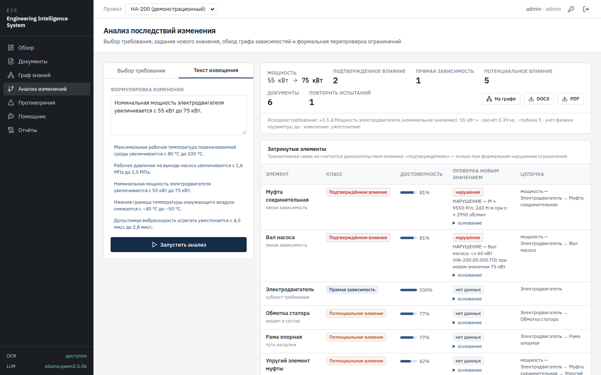
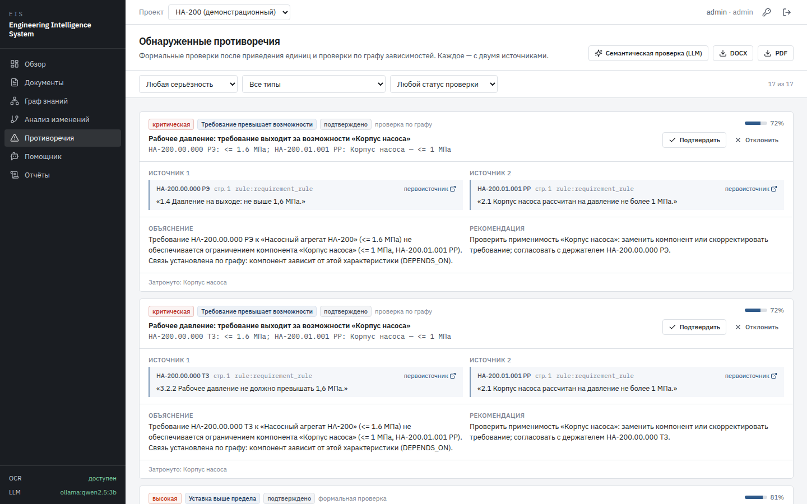
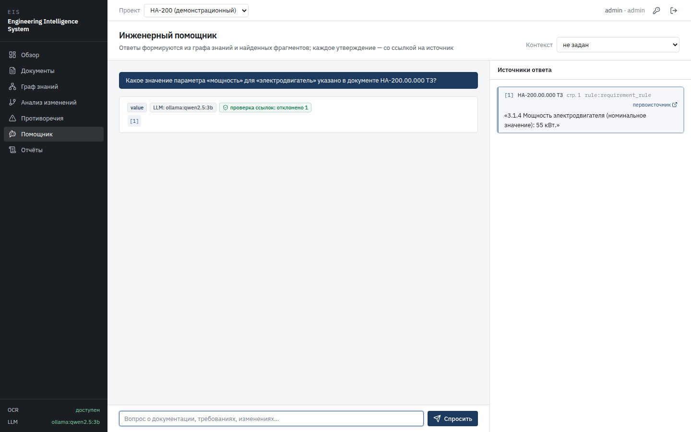

# EIS — Engineering Intelligence System

Система анализа инженерной документации энергетического оборудования: показывает, к чему приведёт
изменение технического требования — какие узлы и материалы затронуты, какие ограничения нарушаются,
какие документы пересмотреть и какие испытания повторить, — и находит противоречия в действующей
документации. Каждый вывод — с цитатой и пунктом документа. Работает полностью локально, на открытом ПО.

Извлечение требований с привязкой к первоисточнику (PDF, DOCX, XLSX, CSV, TXT, сканы) → типизированный
граф знаний → формальные проверки ограничений с учётом физики и направления изменения → классы влияния →
противоречия → помощник с обязательными ссылками (локальная LLM — опционально).

Стипендиальный конкурс «Система» 2026–2027, номинация «Технологии в электроэнергетике и электротехнике».
Автор — Селивохин Я. А., МГУ имени М. В. Ломоносова.

> Демонстрационные документы (насосный агрегат НА-200) **синтетические** и созданы для демонстрации.



## Результаты (набор test, 33 сценариев изменения, 95% доверительные интервалы)

| Метод | F1 затронутых компонентов | F1 документов на пересмотр |
|---|---|---|
| Поиск по ключевым словам (BM25) | 0,68 [0,58; 0,75] | 0,77 [0,74; 0,80] |
| Семантический RAG | 0,69 [0,59; 0,77] | 0,76 [0,73; 0,80] |
| Обход графа без правил | 0,78 [0,67; 0,86] | 0,76 [0,72; 0,79] |
| **EIS (гибрид)** | 0,90 [0,84; 0,96] | 0,94 [0,91; 0,96] |

Противоречия: найдено 10 из 10 внесённых, точность 1,00, 0 срабатываний на 7 ловушках
(сходство текста — 2 из 10). Нарушения ограничений: 34 из 34.
16 сценариев — отложенные наборы, прогнанные один раз после доработки. Все цифры, первые прогоны до
исправлений и ограничения — в [журнале экспериментов](docs/experiments_log.md); эксперименты E4 (сканы),
E5 (масштабируемость), E6 (локальная LLM) — там же. Видео демонстрации — [docs/competition/demo.mp4](docs/competition/demo.mp4).

| Противоречия | Помощник с цитатами |
|---|---|
|  |  |

## Быстрый старт (локально)
```bash
python3.12 -m venv .venv
.venv/bin/pip install --index-url https://download.pytorch.org/whl/cpu torch
.venv/bin/pip install -r backend/requirements.txt
.venv/bin/python dataset/generator/build.py            # синтетический датасет + эталон
cd backend && ../.venv/bin/uvicorn eis.api.app:app --port 8000
cd frontend && npm ci && npx vite                       # http://localhost:5173
```
Вход: `admin` / значение `EIS_ADMIN_PASSWORD` (по умолчанию `admin` — смените: значок ключа в шапке интерфейса). На «Обзоре» — кнопка
загрузки демонстрационного набора. Для OCR сканов: `sudo apt install tesseract-ocr tesseract-ocr-rus`.

## Docker
```bash
cp .env.example .env               # задать EIS_SECRET_KEY и EIS_ADMIN_PASSWORD (файл не коммитится)
docker compose up --build          # http://localhost:8000 (PostgreSQL + backend + собранный фронтенд)
EIS_PORT=8080 docker compose up --build  # если порт 8000 занят
docker compose --profile llm up    # + локальная LLM через Ollama (EIS_LLM_PROVIDER=ollama)
```

LLM необязательна: без неё система работает полностью. Docker + Ollama на хосте:
```bash
OLLAMA_HOST=172.17.0.1:11434 ollama serve &       # адрес моста docker0 — доступен контейнерам, не локальной сети
EIS_LLM_PROVIDER=ollama EIS_LLM_URL=http://host.docker.internal:11434 docker compose up -d
```
С локальной Ollama без Docker:
```bash
ollama serve & ollama pull qwen2.5:3b
EIS_LLM_PROVIDER=ollama EIS_LLM_URL=http://127.0.0.1:11434 EIS_LLM_MODEL=qwen2.5:3b \
  ../.venv/bin/uvicorn eis.api.app:app --port 8000          # из backend/
```
Эксперименты: `./experiments/run_all.sh` (E1–E3), `experiments/eval_noise.py` (E4, сканы),
`experiments/eval_scale.py` (E5), `experiments/eval_llm.py` (E6, нужна Ollama). Журнал — `docs/experiments_log.md`.

## Эксперименты
```bash
./experiments/run_all.sh           # датасет → E1 извлечение → E2 последствия → E3 противоречия
```
Результаты — `experiments/results/`, журнал прогонов и ограничения — `docs/experiments_log.md`.

## Тесты
```bash
cd backend && ../.venv/bin/python -m pytest -q
```

## Структура
| Путь | Содержание |
|---|---|
| `backend/eis/parsing` | парсеры PDF/DOCX/XLSX/CSV/TXT/изображений (OCR) → фрагменты с местом в документе |
| `backend/eis/extraction` | единицы измерения, словарь параметров, морфологический поиск сущностей, правила, конвейер |
| `backend/eis/graph` | `GraphStore` и реализация на NetworkX |
| `backend/eis/services` | анализ изменений, противоречия, помощник, разбор извещений, отчёты |
| `backend/eis/llm` | провайдеры LLM (нет / Ollama / OpenAI-совместимый) и проверка ссылок |
| `backend/eis/api` | REST API, аутентификация, аудит |
| `dataset/generator` | модель изделия (источник истины), генерация документов и эталона |
| `experiments` | методы M1–M4, оценка E1–E3 |
| `docs` | проектирование, решения (ADR), журнал экспериментов |
